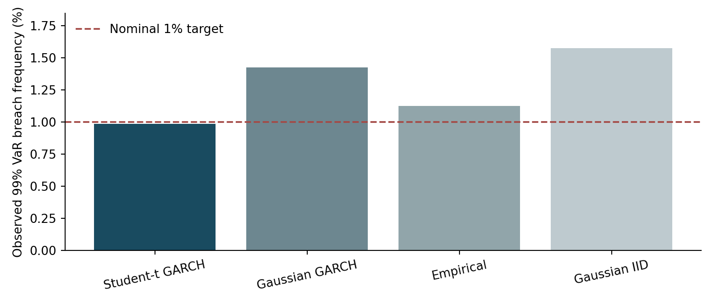
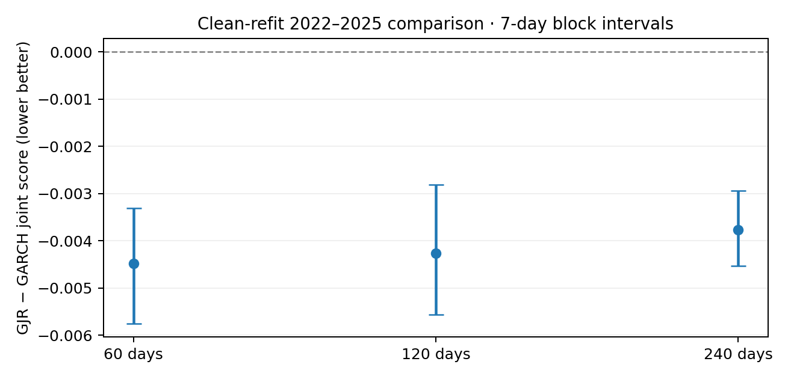
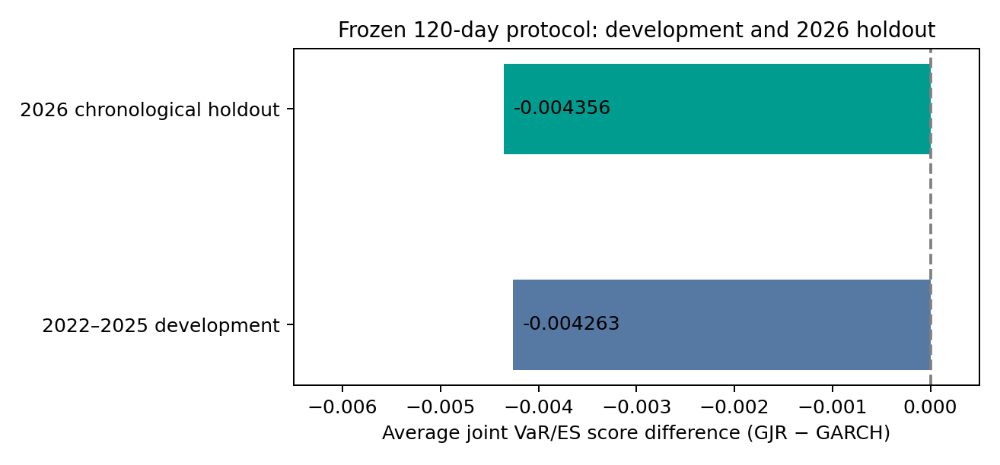
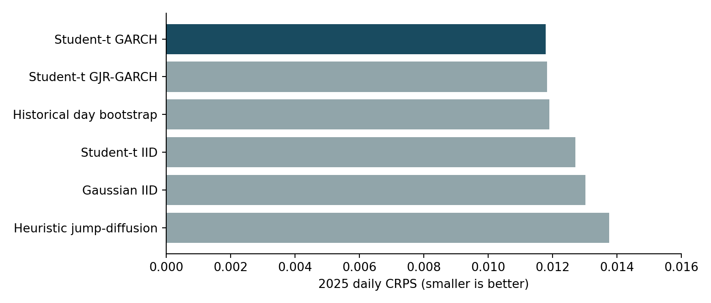
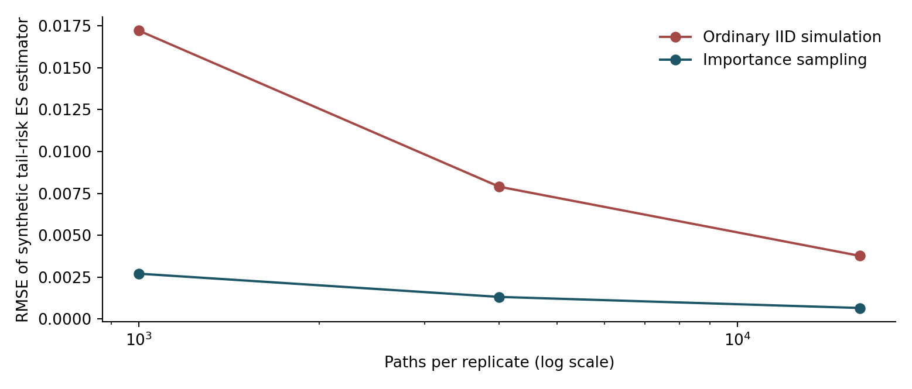

# Abstract

This research examines whether heavy-tailed and asymmetric conditional-volatility models improve extreme-risk forecasting for Binance spot BTC/USDT returns. The development dataset comprises five-minute candles from January 2021 through December 2025, augmented by a **preselected January–October 2026 chronological evaluation**. The original 60 monthly archives have been checksum-verified and all 525,667 saved development returns independently reconstructed to numerical precision; four extreme five-minute events were cross-checked against Binance one-minute archives, though those separate archives lack independently verified publisher checksums. Four experimental protocols are distinguished: baseline five-minute Value at Risk (VaR)/Expected Shortfall (ES) diagnostics; a **cleanly refitted 2022–2025** symmetric-versus-asymmetric Student-t GARCH comparison; a frozen-protocol **2026 chronological holdout**; and a distinct frozen-parameter daily Monte Carlo simulation study evaluated on 2025. Across 420,751 five-minute observations per configuration in 2022–2025, asymmetric GJR-GARCH has lower joint VaR/ES score at 60-, 120-, and 240-day lookbacks (score differences −0.004480, −0.004263, and −0.003762). All 102 development refits converged in the corrected run. With the 120-day lookback fixed in advance, 2026 evaluation covers 87,552 returns over 304 days: GJR-GARCH improves the average joint score by **−0.004356**, with a seven-day block-bootstrap 95% interval [−0.006363, −0.002732]. Both models nonetheless exceed the nominal 1% VaR breach target. The original Student-t GARCH baseline achieves near-target aggregate VaR coverage but fails an exceedance-independence diagnostic. In a separate 2025 daily Monte Carlo comparison, symmetric Student-t GARCH has the lowest estimated CRPS, narrowly ahead of GJR-GARCH; the protocols are not directly comparable. This is a reproducible, internally checked research manuscript, **not a peer-reviewed or fully independent external replication**.

**Keywords:** Bitcoin; Value at Risk; Expected Shortfall; GARCH; GJR-GARCH; Monte Carlo; tail risk; backtesting.

# 1. Introduction

Financial returns exhibit abrupt losses and time-varying volatility that are poorly represented by a single, unconditional Gaussian law. In quantitative risk management, the distinction between the overall frequency of tail events and their timing or severity is consequential. A model can achieve nearly nominal Value at Risk (VaR) coverage yet fail to anticipate clustered exceedances or the magnitude of the losses beyond the VaR threshold.

We ask three related questions: **(Q1)** Do heavy-tailed volatility specifications improve tail forecasts relative to Gaussian and empirical baselines? **(Q2)** Does asymmetric volatility response improve risk-model scoring consistently across lookback windows and market regimes? **(Q3)** Can independently simulated market scenarios reproduce the daily return distribution on unseen data, and how stable are Monte Carlo tail estimators numerically?

We deliberately treat the three evaluations as separate experiments. The five-minute rolling VaR/ES scores in V0.9 cannot be interpreted as directly comparable to the daily, frozen-parameter Monte Carlo scoring in V1.0. Their target quantities, update rules, and effective samples differ.

# 2. Data and reproducibility

## 2.1 Source and validation

The analysis uses Binance spot BTC/USDT five-minute kline archives, monthly January 2021–December 2025, as assembled in STOCHASTIC LAB V0.7.1. Binance's public-data specification documents monthly archives, separate checksum files, and a timestamp-unit change beginning in 2025 [1]. The 60 development-month archives were checksum verified during ingestion. In a subsequent independent local reconstruction, all 525,667 saved five-minute returns and timestamps matched the reconstructed sequence, with maximum absolute return deviation approximately $10^{-16}$. Four extreme event intervals also matched recomputed returns from separate one-minute Binance archive files; the one-minute archive checksums were not available for separate verification. Ten additional monthly archives (January–October 2026) were downloaded and SHA-256 verified by the same program.

The processing pipeline reported **525,667 usable five-minute returns**, **213 missing candles**, **seven gaps**, and a **285-minute maximum detected gap**. No return crosses a missing interval. Calendar-day segmentation and complete-day filters are specified separately for each experiment. The 2021–October 2026 aggregation generated 613,219 valid five-minute returns across 70 monthly archives; `continuous=False` indicates gaps remain and are not filled. The distinct 2025 Monte Carlo holdout contains 365 complete UTC days (288 five-minute increments per day). Data integrity and same-exchange cross-resolution agreement do not establish independent-exchange confirmation of exceptional price prints.

## 2.2 Temporal alignment and units

For a valid five-minute close-to-close interval, the log return is

$$ r_t = \log(P_t/P_{t-1}). $$

VaR and ES are expressed as **losses in log-return units**, not percentages of a leveraged portfolio, and not cash P&L. A reported VaR of 0.004 represents roughly 0.4% log-return loss for that five-minute horizon; conversion to a simple percentage is only approximately equal for small moves. Five-minute and one-day VaR thresholds must never be placed on the same numeric comparison axis without horizon adjustment.

# 3. Methods

## 3.1 Tail-risk targets

Define the loss $L_t=-r_t$. For tail probability $\alpha=0.01$, 99% VaR is the conditional 99th percentile of loss, and ES is the conditional expected loss in the upper 1% tail (with the usual continuity assumptions). A breach is $I_t=\mathbf{1}\{L_t>\widehat{\mathrm{VaR}}_t\}$. Calibration requires more than matching the average breach rate: conditional information and expected shortfall also matter.

The first experiment uses an unconditional-coverage likelihood-ratio diagnostic and a first-order breach-independence diagnostic in the spirit of interval-forecast evaluation [2]. A zero or low p-value in large dependent samples is not itself an economic effect size. Joint VaR/ES scoring follows the principle that the pair can be evaluated by a proper joint scoring function; the **implementation-specific score is only comparable within the same scoring definition and observation protocol**. The existing program's mean ES-identification statistic and day-clustered intervals are reported as diagnostics, **not** as a complete distribution-free ES calibration proof.

## 3.2 Volatility models

The principal conditional variance formulations are

$$ r_t=\mu+\sqrt{h_t}\,\varepsilon_t, \qquad h_t=\omega+\alpha_G u_{t-1}^2+\beta h_{t-1}, $$

for symmetric GARCH(1,1), and

$$ h_t=\omega+\big(\alpha_G+\gamma\mathbf{1}\{u_{t-1}<0\}\big)u_{t-1}^2+\beta h_{t-1}, $$

for asymmetric GJR-GARCH(1,1), with $u_t=r_t-\mu$. Innovations are standardized Student-t under the heavy-tail variants. The asymmetric form allows negative shocks to have a different effect on subsequent volatility [3]. In the packaged implementation, variance dynamics are fitted by Gaussian quasi-maximum likelihood, followed by separate fitting of Student-t degrees of freedom on standardized residuals; this is **not** a jointly maximized Student-t likelihood.

At observed calendar-day starts and detected gaps, the estimated volatility state is reset to an unconditional estimate. That rule avoids bridging discontinuities but may discard persistent cross-day risk information. Parameter fitting must use only observations preceding the scored point. The repaired clean model comparison refits every 90 observed days under fixed 60-, 120-, or 240-day history windows; all reported model fit training periods end strictly before their evaluation start times.

## 3.3 Distinct experimental protocols

**Experiment A (V0.7/V0.8; five-minute).** Four models—Gaussian IID, empirical, Gaussian GARCH, Student-t GARCH—are evaluated at 499,783 common five-minute timestamps spanning 1,736 evaluation days. The previously audited implementation uses a 90-day training window and approximately 30-day refitting for this experiment, rather than the originally described expanding window.

**Experiment B (corrected V1.1.3; five-minute).** Following identification of 13 non-converged fits in the original V0.9 evaluation, all model configurations were rerun using a constrained multistart optimizer. There are **102/102 converged refits** across paired symmetric Student-t GARCH and asymmetric Student-t GJR-GARCH specifications, with 60-, 120-, or 240-observed-day lookbacks and a 90-day refit cadence. Each configuration is scored on **420,751 timestamps across 1,461 days in 2022–2025**. Paired score differences are aggregated over common timestamps; exploratory dependence-aware moving-block intervals use block lengths 3, 7, 14, 30, and 60 observed days. The precise implementation has a two-stage Student-t calibration and is not a jointly maximized Student-t likelihood.

**Experiment D (V1.1.4; 2026 frozen primary holdout).** The 120-observed-day lookback, 90-day refitting cadence, model pair, and joint VaR/ES score were declared before the January–October 2026 score comparison. Each refit uses only preceding data (including permitted late-2025 training observations). The result includes **87,552 matched five-minute returns over 304 evaluation days**, with four model refits per specification (eight in total). Five prelisted day-block bootstrap lengths (3–60 days) are reported. This is a later chronological sample and therefore stronger than an in-sample comparison, but it is not a truly blinded preregistered trial: the authors had encountered some 2026 Bitcoin information during other project work.

**Experiment C (V1.0; daily Monte Carlo).** Parameters are calibrated to 2021–2024 returns, with the GARCH optimizer restricted to the most recent **70,000 training returns**. Each candidate generates 10,000 paths of 288 five-minute increments. Simulated daily outcomes are compared with **365 complete held-out UTC days in 2025**. Simulations start with an unconditional volatility state and are **not recalibrated or conditioned sequentially on 2025 data**. Models include Gaussian IID, standardized Student-t IID, Student-t GARCH, Student-t GJR-GARCH, complete-day historical bootstrap, and an exploratory heuristic jump mixture. Daily continuous ranked probability score (CRPS) is estimated empirically using at most 2,000 simulated daily observations in the scoring routine. These estimates have numerical sampling uncertainty.

**Numerical experiment (V0.8).** A separate known-Gaussian synthetic tail model compares ordinary IID sampling with exact-likelihood-ratio importance sampling over 120 independent repetitions and 1,000, 4,000, and 16,000 paths per repetition. This experiment validates a numerical technique on a controlled target; it does not validate Bitcoin forecasts.

# 4. Empirical results

## 4.1 Unconditional coverage versus clustering

{ width=95% }

| Model | VaR exceedance frequency | Breaches | Kupiec unconditional p | Independence p |
|:--|--:|--:|--:|--:|
| Student-t GARCH | 0.987% | 4,933 | 0.356 | 1.30 × 10^-31 |
| Gaussian GARCH | 1.426% | 7,125 | ~1.01 × 10^-177 | 1.81 × 10^-43 |
| Empirical | 1.126% | 5,628 | ~1.61 × 10^-18 | Extremely small |
| Gaussian IID | 1.576% | 7,877 | Extremely small | Extremely small |

Student-t GARCH matches aggregate nominal VaR exceedance frequency comparatively well. The same forecasts produce strong evidence against first-order breach independence under the specified asymptotic diagnostic. Thus, **aggregate calibration alone does not imply conditionally reliable risk forecasts**. The extremely small p-values should not be interpreted as independence-free guarantees: the assumptions of the asymptotic test and serial dependence in intraday markets deserve scrutiny.

The Student-t GARCH mean predicted ES on breach observations was approximately 0.385% in five-minute loss units, against approximately 0.421% realized mean breach loss. In the existing gap-safe run, its mean ES-identification statistic was 0.000364 with a reported day-clustered interval [0.000270, 0.000462]. This suggests remaining tail-severity mismatch under that diagnostic, despite nominal VaR coverage; alternative ES calibration tests should corroborate it before a stronger claim is made.

## 4.2 Corrected 2022–2025 asymmetric model comparison

{ width=95% }

| Historical window | Clean-refit average difference (GJR minus GARCH) | 7-day block 95% interval |
|:--|--:|:--|
| 60 observed days | −0.004480 | [−0.005752, −0.003306] |
| 120 observed days | −0.004263 | [−0.005558, −0.002816] |
| 240 observed days | −0.003762 | [−0.004536, −0.002942] |

The **clean 102-fit rerun supersedes the original V0.9 score estimates**, which were affected by non-converged optimizer outputs. Negative differences favor GJR-GARCH under the fixed joint VaR/ES score; they are **not** profit estimates or improvements in basis points. All fifteen exploratory bootstrap intervals (three windows × five block lengths of 3, 7, 14, 30, and 60 days) exclude zero. This is robust to those block-length choices, but not a universal proof across data sources, regimes, or model families.

## 4.3 Frozen-protocol 2026 chronological evaluation

{ width=95% }

| Held-out 2026 statistic | Symmetric Student-t GARCH | Asymmetric Student-t GJR |
|:--|--:|--:|
| Common evaluated observations | 87,552 | 87,552 |
| Days | 304 | 304 |
| Converged parameter refits | 4/4 | 4/4 |
| 99% VaR breaches | 940 | 932 |
| Observed breach rate | 1.0736% | 1.0645% |
| Mean joint VaR/ES score | −5.533723 | **−5.538078** |
| Mean ES-identification diagnostic | 0.000033 | 0.000019 |

The paired **GJR minus GARCH mean joint-score difference is −0.004356**, compared with −0.004263 for the corresponding 120-day development evaluation. Its seven-day block-bootstrap interval is [−0.006363, −0.002732]; the 3-, 14-, 30-, and 60-day alternatives also exclude zero. The saved run manifest identifies the input data hash and source-code hashes, and both embedded 120-day CSV hashes match the manifest. All saved refit training endpoints precede the corresponding evaluation dates. These audits support reproducibility of the **saved outputs**, but do not constitute a separate complete reexecution from fresh raw 2026 archives on another machine.

The improvement is small in absolute scoring units and **does not imply exact VaR calibration**: both 2026 breach rates exceed the nominal 1% target. Neither predictive gains on one BTC/USDT exchange series nor exploratory bootstrap intervals establish future profitability, universal superiority, or a guaranteed causal volatility asymmetry effect.

## 4.4 Independent 2025 daily scenario validation

{ width=95% }

| Simulator | 2025 CRPS | 99% daily VaR exceedances | Median simulated daily realized vol. |
|:--|--:|--:|--:|
| Student-t GARCH | **0.011786** | 3 / 365 | 0.01979 |
| Student-t GJR-GARCH | 0.011837 | 2 / 365 | 0.01976 |
| Complete-day bootstrap | 0.011905 | 0 / 365 | 0.02634 |
| Student-t IID | 0.012715 | 1 / 365 | 0.03105 |
| Gaussian IID | 0.013025 | 1 / 365 | 0.03559 |
| Heuristic jump mixture | 0.013760 | 0 / 365 | 0.03939 |

The observed 2025 median daily realized volatility was 0.01932. Both conditional-volatility models are close on this descriptive feature, and symmetric Student-t GARCH has the smallest estimated CRPS in this particular frozen-parameter exercise. Its advantage over GJR is approximately **0.000051**, a small difference for which this manuscript does **not** claim statistical significance. Under 1% nominal VaR and 365 days, about 3.65 exceedances are expected on average, so the observed counts are sparse. The jump-mixture calibration is heuristic and must not be treated as a fully identified structural jump process.

A note on interpretation: the V0.9 asymmetric advantage is about **rolling conditional five-minute VaR/ES forecasting**; the V1.0 symmetric advantage is about **frozen-parameter unconditional daily scenario distributions**. Neither result overturns the other.

## 4.5 Numerical Monte Carlo validation

{ width=95% }

| Paths | IID RMSE | Importance RMSE | Empirical variance reduction |
|--:|--:|--:|--:|
| 1,000 | 0.017219 | 0.002706 | 40.46× |
| 4,000 | 0.007896 | 0.001318 | 36.03× |
| 16,000 | 0.003769 | 0.000656 | 33.25× |

The experiment demonstrates that a correctly weighted importance sampler can improve the efficiency of estimating a tail quantity **when its target distribution is known**. It does not show a 33–40× acceleration for empirical Bitcoin tail risk, where distributional uncertainty, jumps, time variation, and threshold estimation may dominate simulation noise.

# 5. Methodological audit and threats to validity

**Data quality and rare events.** SHA-256 archive verification establishes file agreement with an archived checksum, not that each abnormal price observation is economically valid. Exchange records for the largest five-minute moves should be independently checked, including possible liquidation cascades or data anomalies. Do not assign causes to identified shock dates without corroborating external evidence.

**State resets and model updating.** Intraday state resets reduce the risk of inadvertently bridging missing intervals but can erase economically relevant volatility persistence at midnight. Daily-reset, continuous-filter-with-verified-gaps, and alternative initialization protocols should be compared. Training windows, refit frequency, optimizer convergence and two-stage Student-t calibration all influence output.

**Statistical inference.** Overlapping or adjacent intraday observations are dependent. The corrected score comparison was checked against five moving-block lengths (3, 7, 14, 30, and 60 days), not merely seven days. Those exploratory intervals nevertheless remain subject to finite-sample assumptions, post-selection bias, and potential multiple-testing effects. The 2026 protocol was selected before scoring but cannot be claimed to be a perfectly blinded prospective design. A formal paired test of V1.0 daily CRPS differences has **not** been conducted. Repeated model selection using 2025 results would compromise the independent holdout for future iteration.

**ES testing.** The current ES-identification and joint score diagnostics should be complemented by conditional ES calibration tests, including predeclared thresholds and a suitable bootstrap for temporal dependence. The average loss conditional on a VaR breach is descriptive and is not an interchangeable replacement for a formal ES backtest.

**Model scope.** BTC/USDT spot klines contain neither true Level-3 queues nor trade-level impact causality. Price-return models cannot claim that they forecast actionable trading profitability. The heuristic jump mixture does not uniquely distinguish jumps from heavy tails or microstructure effects. Daily simulation paths are stylized scenarios and omit transaction costs, market depth and exchange-specific liquidation mechanics.

**Computational reproducibility.** Historical development returns have been independently reconstructed from 60 checksum-verified Binance archives; four extreme returns have been reconstructed from Binance one-minute datasets. The complete development model grid was rerun with a repaired optimizer (102 converged fits). The 2026 holdout archive has internally matched source/result hashes and chronologically valid training boundaries. A separate-machine, environment-locked end-to-end rerun, independent-exchange verification, and formal release tagging remain outstanding.

# 6. Discussion and conclusion

The evidence favors heavy-tail-aware volatility modeling over simple Gaussian IID assumptions on several risk metrics. Student-t GARCH is close to the target unconditional five-minute exceedance frequency yet has clustered failures, and its ES diagnostic indicates remaining tail-severity mismatch. Importantly, after a **complete clean refit with 102 converged optimizations**, the GJR asymmetric specification improves aggregate joint VaR/ES scores for all three tested training histories in 2022–2025. The **preselected 120-day configuration maintains a comparable average score advantage** in the later January–October 2026 chronological evaluation (−0.004356), with exploratory block-bootstrap intervals remaining negative across five block lengths. Nevertheless, both models exceed the nominal 1% 2026 VaR breach target and the result does not imply trading profitability. A distinct frozen 2025 daily Monte Carlo comparison slightly favors symmetric Student-t GARCH on CRPS; the target horizons and evaluation rules differ. The most defensible conclusion is **protocol-specific**: asymmetric volatility can improve joint five-minute tail-risk scoring for this exchange/asset/sample, while accurate unconditional VaR coverage alone remains insufficient for conditionally reliable tail-risk management.

Future work should prioritize (1) independent-exchange confirmation and published checksum checks for the one-minute verification archives, (2) a truly prospective, externally preregistered holdout or nested forward validation, (3) sensitivity to variance-state resets, fit cadence and Student-t likelihood estimation, (4) dependence-robust paired inference for joint scores and daily CRPS, and (5) coherent ES validation and jump-process estimation. The project provides an openable research platform and a record of specific, falsifiable claims. It is **not** evidence of a profitable or deployable trading system.

# 7. Reproducibility guide

The historical return file is `btc_5m_returns.csv`; the bundled results derive from these STOCHASTIC LAB modules:

| Experiment | Code / output |
|:--|:--|
| Five-minute VaR/ES and baseline | `src/tailrisk_v07.py`; `v07_outputs/` |
| Coverage, joint scoring, synthetic importance sampling | `src/validation_v08.py` and V0.8 outputs |
| Corrected rolling asymmetric robustness | `src/robustness_v09.py`, `full_refit_runner.py`, repaired optimizer; `clean_outputs/` |
| 2026 chronological holdout | Same repaired clean runner, `--windows 120 --start-year 2026`; `holdout_2026_frozen/` |
| Monte Carlo held-out simulation | `src/market_sim_v10.py`; `v10_outputs/` |
| Interactive presentation | `app.py` and offline `OPEN_THIS_NEON_TERRAIN.html` |

The V1.0 repository packages the necessary scripts and results. On Windows, from its project directory:

```powershell
py -m pip install -r requirements.txt
py -m unittest discover -s tests -v
py -m src.market_sim_v10 --returns-csv btc_5m_returns.csv --paths 10000
py -m streamlit run app.py
```

For the corrected rolling comparison, use the V1.1.3 runner with historical inputs and the repaired optimizer. The corrected rerun supersedes the earlier V0.9 optimizer-contaminated results. **Reproducing saved calculations is not the same as independently verifying the source market data.** The neon 3D volatility landscape is a separate descriptive visualization, not a rendering of multiyear model superiority.

# References

[1] Binance. *Binance Public Data: Historical Archives and Checksum Specification.* https://github.com/binance/binance-public-data

[2] Christoffersen, P. F. (1998). Evaluating Interval Forecasts. *International Economic Review*, 39(4), 841–862. https://users.ssc.wisc.edu/~bhansen/718/Christoffersen1998.pdf

[3] Glosten, L. R., Jagannathan, R., and Runkle, D. E. (1993). On the Relation Between the Expected Value and the Volatility of the Nominal Excess Return on Stocks. *The Journal of Finance*, 48(5), 1779–1801. https://doi.org/10.1111/j.1540-6261.1993.tb05128.x

[4] STOCHASTIC LAB project artifacts (2026), `V08_FINDINGS.md`, `V09_FINDINGS.md`, `V10_FINDINGS.md`, and source-code modules cited above. Project-generated empirical evidence; not externally peer reviewed.

# Appendix A. Completed audits and remaining validation boundaries

| Audit area | Evidence in this research package | Assessment |
|:--|:--|:--|
| Original 2021–2025 returns | Reconstructed 525,667 timestamp-aligned log returns from 60 SHA-256-verified monthly archives; maximum absolute discrepancy $\approx 10^{-16}$ | Passed locally |
| Extreme 5-minute events | Four extreme returns reconstructed independently from one-minute Binance archives | Cross-resolution agreement; one-minute checksums unverified |
| Original V0.9 convergence | 13 / 102 fits failed or were penalized | Superseded |
| Clean 2022–2025 comparison | 102 / 102 fits recorded as converged; paired scores recalculated | Saved results verified; full rerun completed on user machine |
| 2026 holdout | 8 / 8 fits converged, 87,552 paired observations, matching archive hashes, training boundaries preceding evaluation dates | Saved output verification passed |
| Inference | Paired block intervals for 3, 7, 14, 30, 60-day block lengths | Exploratory dependence sensitivity; not fully confirmatory |
| Independent source & environment | Independent exchange data, pinned environment, separate-machine complete reproduction | Outstanding |

The audit results above describe which checks were completed and which forms of independent validation remain outstanding.
